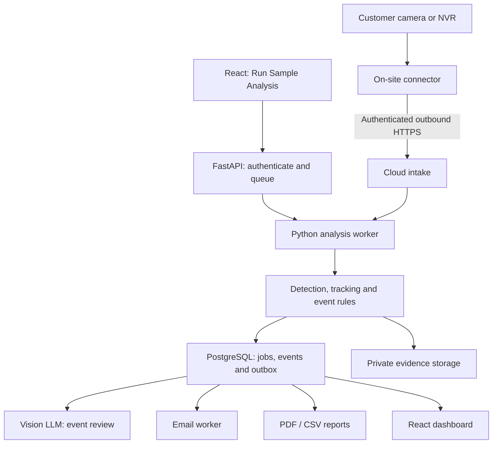

# Team Zenith · CCTV safety and CO₂ monitoring SaaS

Build a service that accepts customer CCTV footage, runs analysis on Zenith’s server, and gives supervisors an alert dashboard, evidence, automatic email, and downloadable reports. “Public safety” in this plan covers sudden incidents in monitored common areas: possible collapse, rapid crowd buildup, and a potentially blocked exit.

## Scope and build order

| Milestone | Deliverable |
|---|---|
| Designathon MVP | **Run Sample Analysis** on short prerecorded clips. Show one restricted-zone alert, one staged public-safety incident, traffic counts and a CO₂ estimate. Include AI evidence review, acknowledgement, test email and PDF export. |
| One-camera pilot | Add a connector that reads one existing CCTV/NVR stream. Monitor one configured site continuously, send email to its configured responders, and record camera outages and recovery. |
| SaaS expansion | Add more tenants, cameras, camera-specific rules, notification policies and additional validated detectors. |

Use pretrained weights for the MVP. Ship the restricted-zone flow first, then the collapse flow, traffic, and public-safety rules requiring more camera-specific tuning.

## Architecture

| Layer | Implementation |
|---|---|
| Frontend | React, Vite and Tailwind. Safety and Traffic tabs, video overlays, camera health, incident banner, evidence viewer, acknowledge action and download button. Poll run status initially. Label live, uploaded, and replay inputs clearly. |
| API | FastAPI with tenant scoping. Accept packaged source IDs for public sample runs. Create jobs and return promptly. Keep Gemini and mail secrets server-side. |
| Video and rules | OpenCV/FFmpeg, YOLOv8 Nano, ByteTrack and Python rules. Use a dedicated pose checkpoint for collapse. Support a file input adapter and a camera input adapter. Analyze files using source timestamps. |
| Durable state | PostgreSQL for organizations, sites, cameras, rules, runs, events, evidence references, notifications and acknowledgement history. Write incident and notification outbox records in one transaction. Use a leased queue for initially small volumes. |
| Evidence | Local mounted directory for the MVP and private object storage for the pilot. Store event keyframes and short clips where configured. Store immutable originals or derived snapshots according to the site's retention policy. |
| Hosting | Use Docker Compose on one persistent host for FastAPI, workers and PostgreSQL. Serve React on that host or Vercel. For a public demo, offer fixed sample IDs and limit concurrent runs. Keep a recorded replay available. GitHub Actions can process offline batch samples. Continuous monitoring uses the persistent worker. |

### Infrastructure and data contracts

- **Camera intake:** Prefer an on-site connector that reads local RTSP, keeps camera credentials on site and sends timestamped frames or short chunks outbound over HTTPS. Include camera ID, source timestamp, sequence number and stream session ID. Authenticate and scope credentials per camera. Use bounded buffering and track frame gaps.
- **Event record:** Store tenant, camera, event type, zone, start/source timestamp, processing timestamp, severity, rule version, evidence references, independently stored AI review status, acknowledgement and resolution history. Keep UTC internally and show the site timezone.
- **API examples:** `POST /runs`, `GET /runs/{id}`, `GET /runs/{id}/events`, `POST /events/{id}/acknowledge`, `GET /runs/{id}/report.pdf`. Authorize every read and write against tenant or demo-session ownership.
- **Output:** Provide report filters for camera, date or run. Include safety events, evidence and review status, camera outages, traffic counts, distance, factor sources and CO₂ assumptions. Make screenshots and report links accessible only to the authorized audience.

## Detection and response

| Trigger | Detection logic | What happens |
|---|---|---|
| Restricted-zone entry | Track the person's bottom-centre bounding-box point against a configured polygon. Require a short dwell and use an exit rule to reset. | Create a site safety alert with time, zone and evidence. |
| **Possible collapse** | Use pose keypoints and the track history to look for a rapid upright-to-low transition followed by sustained low posture. Tune time intervals on staged clips. Compare against sitting, kneeling and deliberately lying down. Mark obscured joints or lost tracks as low-evidence. | Show **Possible person down** and email the designated on-duty site responder. Ask the operator to verify the video and follow the site's response procedure. |
| **Rapid crowd buildup** | Count tracked people within a configured polygon. Compare the count and its change over a short time window against limits set for that camera. Use hysteresis to avoid repeating the same alert. | Show an occupancy trend and notify site staff when the configured threshold persists. If people are heavily occluded, mark the count as uncertain. |
| **Possible exit obstruction** | Use a fixed camera and a marked exit corridor. Treat persistent corridor occupancy as a candidate. Compare moving people with a stationary obstruction and show the supporting frames for review. | Create a review alert and route it to the designated facilities or safety contact according to site policy. |
| Traffic and CO₂ | Track vehicles crossing a directional line. Count each valid track crossing once for the chosen segment. Calculate `sum(count_by_class × distance_km × factor_g_per_vehicle_km)`. | Show counts and a segment estimate with all assumptions. Mark the estimate partial if inputs are missing or an interval was unobserved. |

**Sudden-incident workflow**

1. Create a **suspected** incident as soon as the configured rule fires. Persist the event, its notification task and whatever evidence is already available.
2. Show the dashboard alert and notify the configured on-duty staff. Use the camera, time, location and observed signal in the message.
3. When available, attach three frames from before, during and after the event. Send them to the vision LLM asynchronously. Request structured JSON with the observation, supporting frame IDs and `visible`, `unclear` or `contradicted`.
4. Let the operator acknowledge, confirm or dismiss the event and record the action taken. Configure one escalation to a designated backup contact if a high-priority event remains unacknowledged for the site's chosen interval.
5. Keep dispatch, announcements and decisions affecting people under the site's existing human response process. Restrict the system to observations and configurable internal alerts.

## Automatic emails and health monitoring

- **Incident emails:** Send with a transactional provider such as Resend. Use predictable templates and configured recipients. Keep recipient choice and severity in explicit rules. Example subject — `[Zenith] Possible person down · CAM-01`. Link to the evidence in the dashboard.
- **Health alerts:** A separate watchdog checks camera frame freshness, worker heartbeat, queue age and storage availability. Send one notice on an outage and one on recovery. Use an external uptime probe for the cloud API.
- **Daily digest:** Optionally summarize incident counts, time-to-acknowledge and camera outage periods from saved records. If the vision model is unavailable, send the same data as a template.
- **Delivery state:** Track sent, delivered, delayed and bounced independently from operator acknowledgement. Verify provider webhooks and deduplicate their events. Start in preview mode or use a designated test inbox.

## Failure handling

| Failure | Fallback |
|---|---|
| Vision model unavailable, slow or returns invalid JSON | Keep the original alert and evidence visible. Retry separately with a cap and mark the AI review unavailable if retries expire. |
| Worker restarts | Reclaim expired leases. Use deterministic event or crossing keys per run and uniqueness constraints. Validate that rerunning an interrupted clip cannot double-count crossings or enqueue duplicate emails. |
| Email API timeout | Retry transient errors with exponential backoff and a stable event-recipient idempotency key. Reconcile ambiguous sends with provider state before retrying outside the provider's deduplication window. Mark permanent bounces for follow-up. |
| Camera/network outage | Reconnect with backoff. Surface stale/offline status and missing intervals. Mark restored frames with their original capture times. Send separate recovery notification. |
| Processing backlog | Bound queues and favor recent frames for live monitoring. Make dropped frame intervals visible. Mark any affected traffic and safety coverage as incomplete. |
| Bad footage, low visibility or missing pose | Show a quality issue or an unverified observation. Keep the underlying timestamp and camera. |
| Evidence or PDF storage unavailable | Keep the event record, allow artifact regeneration and offer CSV when PDF generation is unavailable. |
| Hosting outage during presentation | Use a labelled replay with saved model outputs, report and evidence. Keep the local Docker Compose demo ready. |

## Input data and research references

| Input | Where to get it | How to use it |
|---|---|---|
| Restricted zone | Record a fixed phone view of a taped zone. Include one entry and one walk-past. | Time-label the crossing or label the clip negative. Use it to validate alerts and email. |
| Public safety | Record short staged clips with consenting participants. For collapse tests, use safe transitions to simulate the final posture and include sit, kneel and obscured-view negatives. For exits and crowd buildup, stage normal passage and persistent occupancy separately. | Start with these before looking for benchmarks. Set the expected event, approximate timestamp and expected recipient route in a test manifest. |
| Traffic | [Roboflow Supervision vehicle sample](https://github.com/roboflow/supervision/blob/develop/docs/how_to/count_in_zone.md) and [UA-DETRAC](https://sites.google.com/view/daweidu/projects/ua-detrac) | Use the sample for a quick run and the benchmark for fixed-camera detection and tracking. Compare against manual directional counts. |
| PPE | [SH17 on Kaggle](https://www.kaggle.com/datasets/mugheesahmad/sh17-dataset-for-ppe-detection) and [authors' GitHub with weights](https://github.com/ahmadmughees/SH17dataset) | Later helmet and vest tests. Try the published YOLO weights before training. |
| Smoke and fire | [MIVIA Smoke Detection Dataset](https://mivia.unisa.it/datasets/video-analysis-datasets/smoke-detection-dataset/) and [D-Fire](https://github.com/gaia-solutions-on-demand/DFireDataset) | Later dedicated detector evaluation. Include glare and steam as challenging negatives where relevant. |
| CO₂ factors | [India GHG Program road transport paper](https://indiaghgp.org/sites/default/files/Road%20Transport%20Technical%20Paper.pdf) | Record the exact vehicle and fuel assumptions and align factor units with vehicle-kilometres. |

Use staged or redistribution-approved clips on the public site. Record dataset terms, source and permitted use before reusing assets. Review detector and weight licenses before commercial deployment.

- **Evidence selection:** Compare one frame versus three frames on the same incidents. Score whether the model identifies the correct event and supports its observation with the right frame. [LAVAD, CVPR 2024](https://openaccess.thecvf.com/content/CVPR2024/html/Zanella_Harnessing_Large_Language_Models_for_Training-free_Video_Anomaly_Detection_CVPR_2024_paper.html) · [Holmes-VAD](https://arxiv.org/abs/2406.12235)
- **Reuse code:** Start with [Ultralytics ObjectCounter](https://github.com/ultralytics/ultralytics/blob/main/ultralytics/solutions/object_counter.py) for traffic counts and [Kavach](https://github.com/VividhDesign/kavach) as a reference for zones and pose-based man-down rules. Use [Frigate’s tracked-object descriptions](https://docs.frigate.video/configuration/genai/genai_objects/) as a comparable implementation.
- **Road estimate:** Start from [Connecting Vision and Emissions](https://arxiv.org/abs/2506.18924). Add calibrated distance and speed for a later evaluation using the method in [Road pollution estimation from vehicle tracking](https://doi.org/10.1016/j.asoc.2021.107950).

## Implementation instructions for the coding agent

1. **Build one end-to-end route first.** Add React, API, worker and database to Compose. Seed two staged safety clips and a sample zone. The **Run Sample Analysis** button must execute real inference. The entry produces one alert and the walk-past produces zero.
2. **Finish the supervisor workflow.** Add evidence thumbnails, three-frame review, acknowledgement, test email and the PDF. Verify that Gemini failure does not prevent alerting and that a duplicate email task does not send twice.
3. **Add sudden-incident handling.** Run the possible-collapse rule on a staged positive and sitting/kneeling negatives. Display the evidence, notify the test recipient and check acknowledgement plus escalation behavior. Add crowd and exit rules only after recording and labelling representative clips.
4. **Add the traffic tab.** Reuse line counting, check it manually, and show factor units and assumptions next to the CO₂ estimate. Confirm the PDF matches the UI.
5. **Deploy and verify.** Open the hosted dashboard from another device. Test fresh analysis, evidence, test email and PDF download. Then connect one camera and simulate an outage and recovery. Verify tenant isolation and retention before admitting customer footage.

**MVP acceptance:** A judge can start a fresh run, see a rule-generated alert and its evidence, acknowledge it, see the test email workflow, and download a PDF containing the safety event and traffic estimate. Report which sudden-incident rules were actually validated on footage.

